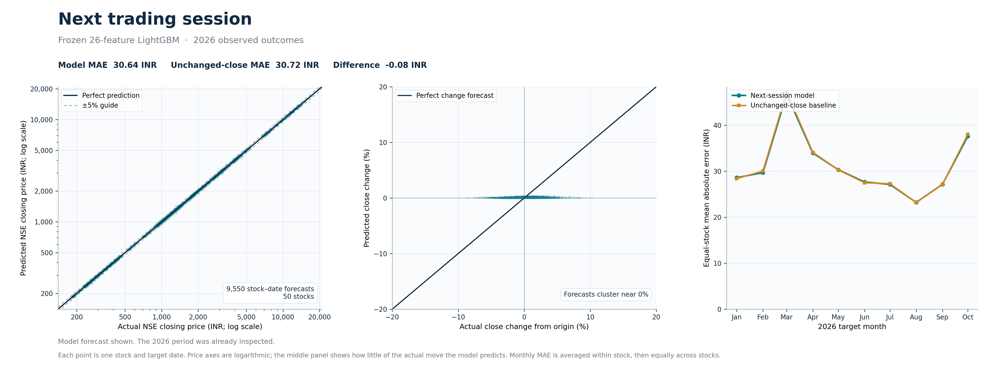
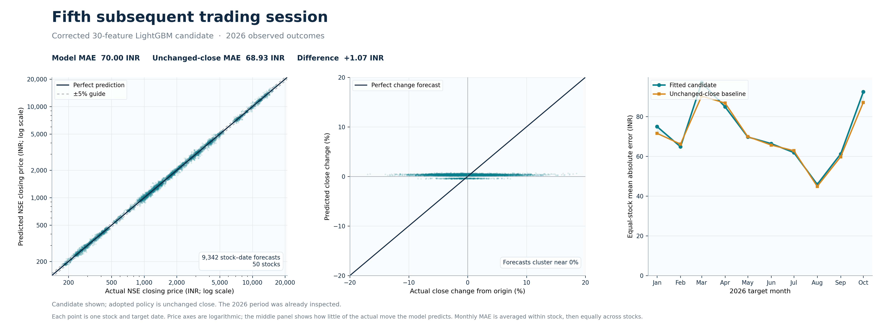

# Historical results for the two retained models

Verified on 16 October 2026 against the locked market-data release ending 13 October 2026. Both candidates fit only labels ending by 31 December 2024. Values below are equal-stock mean absolute error in rupees; lower is better.

| Horizon and period | Fitted candidate | Unchanged close | Eligible rows | Stocks improved |
| --- | ---: | ---: | ---: | ---: |
| Next session, 2025 validation | ₹27.0723 | ₹27.1122 | 12,245 | 37/50 |
| Next session, historical 2026 test | ₹30.6368 | ₹30.7180 | 9,550 | 34/50 |
| Fifth session, 2025 validation | ₹64.8567 | **₹64.4432** | 12,019 | 14/50 |
| Fifth session, historical 2026 test | ₹70.0028 | **₹68.9343** | 9,342 | 7/50 |

The next-session model has a small historical advantage over unchanged price on these two periods. The corrected fifth-session candidate failed the 2025 gate, so its adopted forecast policy is **unchanged close**. The 2026 fifth-session candidate score is exploratory and did not change that policy. Both 2025 and 2026 periods have been inspected repeatedly during development; no fresh blind performance claim follows from this table.

## Predicted versus actual in 2026

Each figure covers all 50 stocks on eligible 2026 target dates. The left panel compares quoted closing prices, the middle panel compares the predicted and realized change from the origin close, and the right panel compares monthly equal-stock rupee MAE with unchanged close. Price axes use logarithmic scales because quotes span roughly ₹172 to ₹17,300. The close-price diagonal alone can look strong because both model and actual prices share the origin close; the change and baseline panels show the forecasting difficulty more clearly.

### Next trading session

[Vector PDF](figures/2026-next-session-predicted-vs-actual.pdf)

### Fifth subsequent trading session

This figure shows the **fitted corrected candidate**. The adopted forecast policy remains unchanged close.

[Vector PDF](figures/2026-fifth-session-predicted-vs-actual.pdf)

The next-session model uses the original 26-feature formulas and equal-stock-history weighting to reproduce its saved results. The corrected fifth-session model uses 30 historical and same-session features, share-consistent OHLCV calculations, and training weights proportional to `origin_raw_close / training_rows_for_stock`. Its LightGBM configuration has 60 trees, seven leaves, depth three, 500 minimum observations per leaf, learning rate 0.01, and L2 penalty 50. Four expanding folds scored 2021–2024 and included zero adjustment. The fifth-session point model is saved even though the policy gate rejected it.

Both paths omit origin-target split/bonus crossings and respect demerger/rights segment boundaries. The event ledger lacks publication timestamps. The retrospective fixed 50-stock basket is not historical index membership. Adjacent five-session outcomes overlap and stocks share trading dates. No live forecast is produced from prices later than 13 October 2026.

To regenerate the feature stores, fitted models, metrics and prediction files, follow the four commands in the [root README](../README.md). Outputs are written to timestamped directories under ignored `reports/generated/`. The selected model run, feature hashes, data release and source checks are recorded in its outputs.
